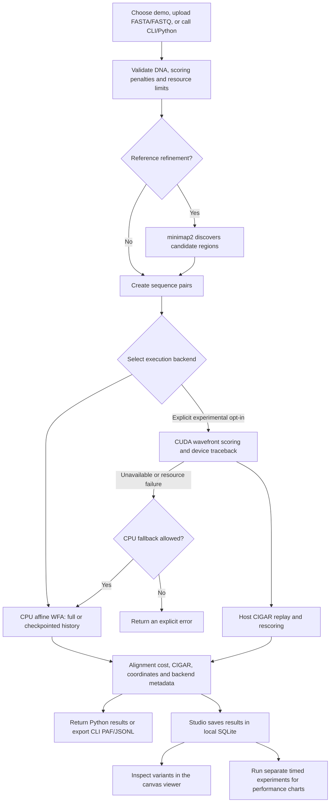
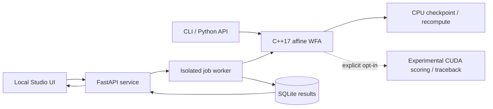

# WarpAlign

**v1.0.0 · CPU-first sequence alignment and local analysis** · [Release notes](RELEASE_NOTES.md)

   

**Align long DNA reads. Inspect every difference. Measure the trade-offs.**

WarpAlign avoids materializing the dense O(n × m) affine-alignment matrix using checkpointed Wavefront Alignment, with a C++17 CPU engine, an experimental CUDA acceleration path, and an interactive local Studio.

[Quickstart](#run-on-localhost) · [Python API](docs/python_api.md) · [CLI](docs/cli.md) · [Architecture](docs/architecture.md) · [Validation report](docs/development_report.md)

## Run on localhost

**Docker is optional.** From your repository checkout, use Python 3.10+, a
C++17 compiler and Node.js 22 or newer supported by Vite:

```sh
python3 -m venv .venv
. .venv/bin/activate
python -m pip install -e '.[studio]'
(cd apps/studio && npm ci && npm run build)
warpalign-studio --port 8000
```

Open **http://localhost:8000** and click **Try a real demo**. No GPU, input files,
accounts, or mapper installation are needed. Keep the terminal running; press
**Ctrl+C** to stop. To start again after installation:

```sh
.venv/bin/python -m warpalign.api --port 8000
```

Ubuntu/WSL users should run these commands inside WSL and open localhost in their
Windows browser. See [installation](docs/installation.md) for C++ and packaging
requirements. A wheel built with the frontend already includes the Studio assets.

### Optional: Docker

```sh
docker compose up --build
```

Or build and run without Compose:

```sh
docker build -t warpalign:1.0.0 .
docker run --rm -p 127.0.0.1:8000:8000 -v warpalign-data:/data warpalign:1.0.0
```

The CPU image builds the frontend and native engine. Compose stores results in
its named `studio-data` volume and publishes only to localhost. Stop it with
`docker compose down`; the named volume preserves results.

The service binds to `127.0.0.1` by default. `--host 0.0.0.0` supports container
networking; host/origin checks remain enabled. This is a local research tool,
not a public authenticated service.

### Optional: minimap2 for reference refinement

Pairwise alignment and the demo do not need minimap2. On Ubuntu/WSL:

```sh
sudo apt update
sudo apt install -y minimap2
minimap2 --version
warpalign doctor
```

Restart Studio after installation to refresh detection. See [mapping integration](docs/minimap2.md)
for reference and read input examples.

## Studio workbench

1. **Try a real demo:** align three seeded 1.2 kb synthetic DNA pairs, including substitutions, a 9 bp insertion and a 6 bp deletion. These illustrate genomic operations; they are not patient data or a calibrated sequencing-platform model.
2. **Inspect automatically:** the completed demo opens the indel alignment in the canvas viewer. Jump between differences, zoom, view coordinates, and export the result.
3. **See measured charts:** the demo records fresh CPU measurements at 100, 500 and 1,000 bp with a warm-up and three timed repeats. Charts appear below the viewer and in Performance Lab.
4. **Bring your own reads:** upload FASTA/FASTQ, select exact or explicitly heuristic alignment, inspect persisted results, cancel jobs, and download PAF/JSONL.

<!-- Add after capturing the real running app; do not substitute a mockup:

-->

Screenshot capture instructions are in [Studio documentation](docs/studio.md).

## How it works



Exact mode retains optimality under the configured affine model. Fast mode is
explicitly heuristic. Checkpointing saves retained CPU history by recomputing
segments during traceback; it trades memory for additional work. Studio charts
use recorded experiments, never estimated or fabricated GPU timings.

## Architecture



The ordinary C++ API remains CPU-only. Python dispatch or the explicit CUDA API selects experimental GPU execution. CUDA includes device traceback and linear host CIGAR replay; GPU validation is still outstanding.

## CLI and Python

```sh
warpalign doctor
warpalign align-pairs --queries tests/fixtures/queries.fa \
  --targets tests/fixtures/targets.fa --backend cpu \
  --checkpoint-interval 128 --output results.paf
```

```python
from warpalign import Aligner

aligner = Aligner(backend="cpu", threads=4, checkpoint_interval=128)
results = aligner.align_batch(["ACGT", "AAA"], ["ACGTT", "AA"])
for result in results:
    print(result.score, result.cigar, result.backend)
```

Costs are minimized: mismatch × substitutions + Σ(gap_open + gap_extend × gap_length). SAM `I` consumes query; `D` consumes reference. Coordinates are zero-based, half-open. Exact resource exhaustion raises an error; inputs are never silently truncated. Minimap2 supplies candidate loci for the optional refinement command—WarpAlign does not replace its seed-and-chain mapper.

## Measured CPU performance

These measurements were captured during 0.2.0 development and are preserved with their original version metadata; they have not been relabeled as new v1 runs. Intel Core Ultra 7 155H, GCC 13.3, Python 3.12, Linux/WSL2. Exact alignment with full CIGAR, one pair/one thread, seed 1729, penalties 4/6/2, 0.2% sampled indel events, and the sampled substitution rates below. Medians exclude warm-up; each configuration runs three repeats in its own process. These are local measurements, not cross-library or GPU speedups.

| Length | Substitutions | Storage | Median ms | Alignments/s | Peak RSS MiB | Wavefront MiB |
|---:|---:|---|---:|---:|---:|---:|
| 1,000 | 0.1% | Full history | 0.04 | 24660.91 | 20.46 | 0.00 |
| 1,000 | 0.1% | Checkpoint 128 | 0.04 | 24629.33 | 20.59 | 0.00 |
| 10,000 | 0.1% | Full history | 1.00 | 996.02 | 20.59 | 0.19 |
| 10,000 | 0.1% | Checkpoint 128 | 1.62 | 617.84 | 20.59 | 0.19 |
| 100,000 | 0.1% | Full history | 45.00 | 22.22 | 32.17 | 11.08 |
| 100,000 | 0.1% | Checkpoint 128 | 82.35 | 12.14 | 24.06 | 2.76 |
| 1,000 | 1.0% | Full history | 0.07 | 14081.73 | 20.59 | 0.01 |
| 1,000 | 1.0% | Checkpoint 128 | 0.09 | 10563.23 | 20.59 | 0.01 |
| 10,000 | 1.0% | Full history | 4.13 | 242.09 | 21.29 | 1.00 |
| 10,000 | 1.0% | Checkpoint 128 | 7.01 | 142.75 | 21.10 | 0.61 |
| 100,000 | 1.0% | Full history | 362.20 | 2.76 | 119.56 | 98.38 |
| 100,000 | 1.0% | Checkpoint 128 | 646.41 | 1.55 | 32.39 | 10.98 |

At 100 kb / 1% substitutions, checkpointing reduced process peak RSS by **72.9%** (119.56 → 32.39 MiB) and accounted wavefront storage by **88.8%** (98.38 → 10.98 MiB), while median latency increased from **362.20 to 646.41 ms**. Small cases may gain little or no memory benefit.

RSS includes imports, input generation, reference scoring and warm-up; wavefront bytes are engine accounting, not total memory. The large-case score reference is CPU exact WFA, not an independent implementation. Independent affine DP validates the small randomized test suite. WFA's memory advantage depends on alignment cost/divergence; checkpointing does not guarantee linear memory for arbitrary reads.

[Raw CSV/JSON, variability and table](benchmarks/results/judge-v020/) · [Methodology](docs/benchmarks.md)

Reproduce:

```sh
python benchmarks/scripts/judge_report.py
```

## Build and validation

```sh
cmake -S . -B build -DENABLE_CUDA=OFF -DCMAKE_BUILD_TYPE=Release
cmake --build build -j2
ctest --test-dir build --output-on-failure
python -m pip install -e '.[test,docs]'
python -m pytest -q
(cd apps/studio && npm test)
python -m mkdocs build --strict
```

`-DENABLE_CUDA=AUTO` probes NVCC and permits a CPU-only build when absent. `ON` requires a CUDA compiler. The legacy `WARPALIGN_CUDA=ON` supplies the default on a fresh build; an explicit/cached `ENABLE_CUDA` takes precedence. CPU headers and Python installation do not require CUDA headers or runtime libraries.

Validation includes **4,000 randomized and 1,922 exhaustive** short-pair affine-DP comparisons, CIGAR replay/rescoring, checkpoint/full/score-only equivalence, ambiguous bases, empty inputs, explicit resource failures and low-divergence cases through 100 kb. The shared device traceback logic is also exercised on the CPU; that does not validate CUDA execution.

## Engineering roadmap and validation status

| Component | Evidence / remaining work |
|---|---|
| CPU C++ engine | CTest and independent oracle tests pass; sanitizer checks pass |
| Python / local API | Real worker, demo, persistence, cancellation, export and benchmark tests pass |
| Studio frontend | TypeScript/Vite build and five viewer tests pass; live browser/screenshot capture remains pending |
| Docker | Multi-stage CPU image, persistent local Compose service and CI smoke test supplied; Docker unavailable here |
| CUDA | Batch scoring, device traceback, bounds checks and strict fallback controls implemented in source; no NVCC/device available for compilation or runtime validation |
| Documentation | Source and local links checked; full MkDocs build pending installation of the docs extra |
| Mapping / comparisons | Real minimap2 forward/reverse synthetic integration test passed; full/checkpoint CPU measurements recorded; WFA2 and other pairwise baseline runs pending |

On an equipped host, run `bash scripts/validate_cuda.sh`; it includes actual device execution and Compute Sanitizer. Enable Python CUDA only with `WARPALIGN_EXPERIMENTAL_CUDA=1`; require execution with `allow_fallback=False` / `--no-fallback`. The [Colab notebook](notebooks/colab_cuda.ipynb) accepts an archive of uncommitted source.

Future work: GPU checkpoint storage, batched device traceback, external WFA2/WFA-GPU/GASAL2 comparisons, real sequencing workloads and broader mapper validation. No first-GPU-WFA, demonstrated GPU-speedup, or clinical-readiness claim is made.

[Prior art](docs/prior_art.md) · [Contributing](CONTRIBUTING.md) · [MIT license](LICENSE)

## Release and contribute

Version 1.0.0 source and release notes are prepared here. [Release instructions](docs/releasing.md) explain building artifacts, checking versions and creating the tag/release after committing your work. No public release is implied by the version label.
