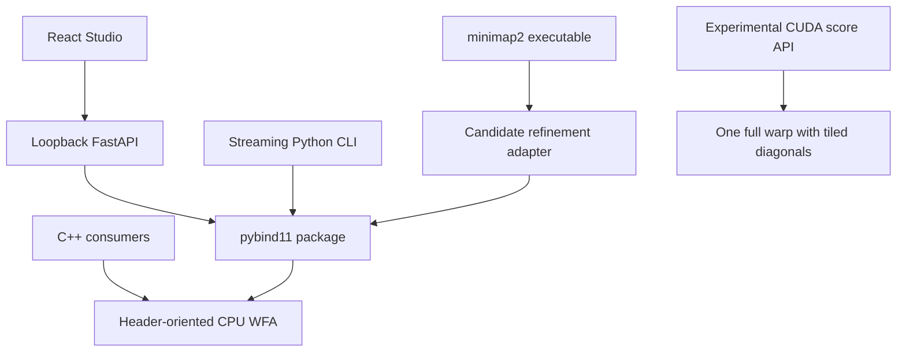

# Architecture decisions

The engine is header-oriented to simplify C++ embedding. Pybind11 is a thin bridge with GIL release; parsing, subprocess orchestration and HTTP lifecycle remain in Python. The CLI intentionally depends on Python while standalone C++ consumers do not. Studio is a static React/TypeScript bundle served by the local API, with no cloud service. SVG charts avoid another plotting dependency and use only recorded values.

CUDA code is a separate experimental target until compilation, runtime correctness, traceback and dispatch integration are validated. This separation prevents an untested kernel from being advertised as production support.
